# Воркфлоу: ANALYZE — Анализ эффективности скила

Фрагмент графа коуча, этап П30. Вход — из П0 по ветке ANALYZE; выход — в П1 для проверки evidence, затем в доказательную классификацию П2. Подтверждённый skill finding проходит атрибуцию, правку и тест; доказательный отрицательный результат — проверку полноты и отчёт; недостаток evidence — сбор или честную паузу; доказанно внешний незавершённый запрос или остаток — передачу с сохранённым результатом.

```mermaid
graph TD
    P30E1["П30 ВХОД: ANALYZE — анализ работы скила на основе завершённых планов, тикетов, отчётов, логов пайплайна и журнала отказов rails. Тикеты из analyzed_tickets (прочитаны в П0) исключены из выборки"]
    P30S1["П30 ШАГ: Сбор данных за период анализа — завершённые тикеты из .workflow/tickets/done/ (результаты, время, качество), планы из .workflow/plans/ (цели, декомпозиция, отклонения), отчёты из .workflow/reports/ (метрики, выводы, проблемы), журнал отказов .workflow/logs/rails-denials.jsonl, журнал запусков агентов .workflow/metrics/agent-runs.jsonl и логи пайплайна за период. Фильтруй по ticket_prefix скила. Исключи тикеты, уже присутствующие в analyzed_tickets"]
    P30S2["П30 ШАГ: Паттерны успеха — какие типы тикетов выполняются хорошо, какие ветки дают стабильный качественный результат, какие knowledge-модули используются чаще всего. Паттерны проблем — какие тикеты завершаются с неполным результатом, где агент отклоняется от графа, какие знания отсутствуют и требуют дополнения, где агент «додумывает» вместо использования knowledge"]
    P30S3["П30 ШАГ: Проверка соответствия процесса — ОБЯЗАТЕЛЬНО для каждого тикета сверь предписанные графом узлы, инструменты и шаги (из SKILL.md скила) с фактически использованными. Факт исполнения — только записи пайплайна: журнал запусков агентов .workflow/metrics/agent-runs.jsonl (стадия, агент, модель, статус, длительность), лог пайплайна, журнал отказов и состояния сессий .workflow/state/rails/ (если сохранились). Секцию «История работы» тикета сверяй с журналом запусков: строку, которой в журнале нет, дописал агент. Сверка с журналом — только для запусков после его первой записи. Журнала нет или период раньше — «не проверено», а не finding. Время строки истории — местное без часового пояса, ts журнала — UTC, подпись агента в истории и в журнале может различаться: строки сопоставляй по стадии, порядку запусков и сдвигу пояса, а не по точному времени и имени. Секция результата, которую пишет исполнитель («Что сделано», поля агента и времени, если они есть), — заявление для сверки, а не факт: свою строку истории исполнитель во время работы не видит, и эти поля бывают копией чужой строки или выдумкой. Расхождение = finding, даже если DoD формально passed. Прогоны 2026-09-29–30: в тикетах двух проектов поле агента называло первый или упавший агент смены исполнителей, время стояло местное с меткой Z со сдвигом до 5 ч, а агенты дописывали свои строки в «Историю работы»"]
    P30S4["П30 ШАГ: Соответствие рельсам поведенчески — node .workflow/src/rails/cli.mjs report --days N --skill имя-скила (журнал проекта) и report --journal .workflow/src/skills/имя-скила/tests/cases/TC-ID/current (журналы прогонов тестов, сохранённые раннером как rails-trial-N.jsonl), затем algorithms/rails-compliance.md (поведенческие метрики): отказы по узлу, узлы с 3 и более повторами в одной сессии, срабатывания потолков, сбросы состояния, отказы выходного слоя, переходы без маркера. Повторяющийся отказ на одном узле — дефект формулировки узла: finding с рекомендацией переформулировать узел, а не ужесточить текст. Срабатывание канарейки — запись с причиной «RAILS_CANARY: рельсы активны» или с типом canary — проверка живости, которой требует узел канарейки, а не отказ: в подсчёт отказов по узлу и порог повторов не входит. Анализ 2026-10-01: отчёт по одному скилу показал 20 отказов P0S1 в одной сессии, все 20 — канарейки перезапусков"]
    P30S5["П30 ШАГ: Gap-анализ — примени algorithms/gap-analysis.md: типы задач, которые приходят, но не имеют ветки графа, знания, которые нужны, но отсутствуют в knowledge, решения, которые принимаются ad-hoc вместо формализованного алгоритма"]
    P30S6["П30 ШАГ: Метрики качества — полнота результата (% тикетов с заполненными всеми секциями DoD), соответствие графу (% тикетов, где агент прошёл предписанные узлы), использование knowledge (частота обращений к модулям), время выполнения (среднее по типам тикетов: длительности запусков стадии исполнения из журнала запусков агентов, а не поля времени, заполненные моделью. За период до первой записи журнала и в проекте без журнала — «не проверено»), балл соответствия рельсам"]
    P30S7["П30 ШАГ: Подготовь доказательные выводы. Зафиксируй подтверждённые сильные стороны, проблемы и возможности улучшения в пределах имеющегося evidence, не заполняй квоту выдуманными findings. Подготовь согласованный конечный manifest источников и проверок, границы анализа, реестр исторических и закрытых пунктов, состояния подтверждённых findings и обязательств основной задачи. Оформи результат по templates/audit-report.md, различая finding, отрицательный диагноз и «не проверено». Неприменимые разделы шаблона обозначь «неприменимо», неизмеренные показатели — «неизмерено»: не выдумывай оценки и не требуй три проблемы ради квоты. Это не разрешает пропуск обязательных источников или проверок. Принятые исправленные инфраструктурные findings учти как закрытые пункты, не как основание передачи всего аудита. Передай результат в П1 для проверки evidence и затем в классификацию П2"]

    P30E1 --> P30S1 --> P30S2 --> P30S3 --> P30S4 --> P30S5 --> P30S6 --> P30S7 --> P1E1
```

